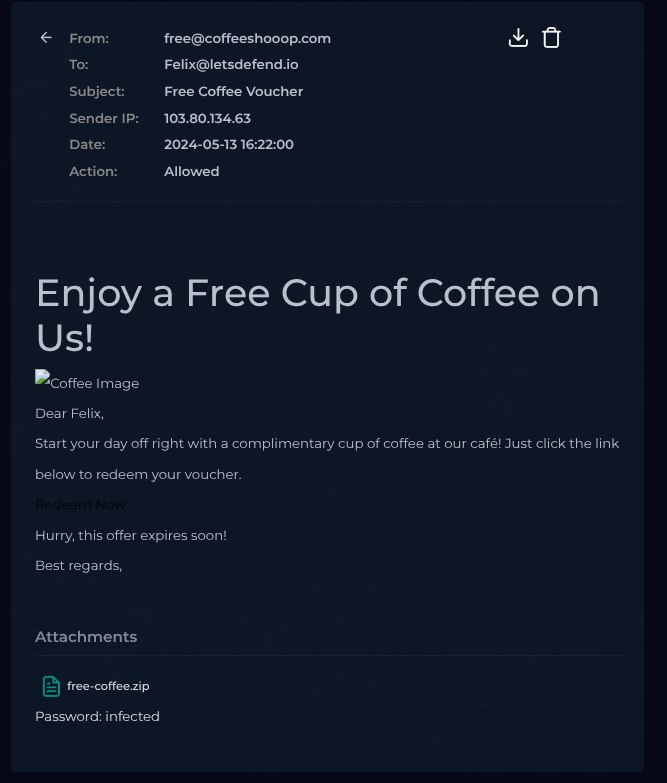
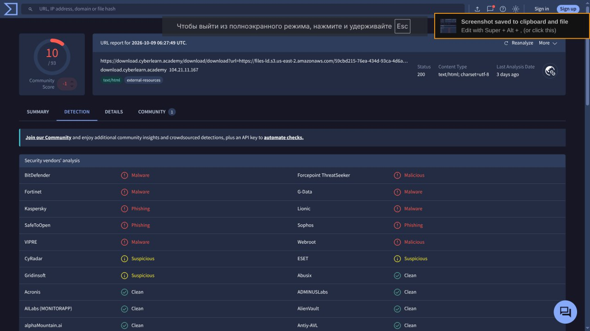

# Case 001 — Phishing «Бесплатный купон на кофе»

## Метаданные

| Поле | Значение |
|------|----------|
| Платформа | LetsDefend |
| Время алерта | 2024-05-13T09:22:00+03:00 |
| Время письма | 2024-05-13 16:20:33 |
| SMTP-сервер | 103.80.134.63 |
| Отправитель | free@coffeeshooop.com |
| Получатель | Felix@letsdefend.io |
| Тема | Бесплатный купон на кофе |
| Действие устройства | Допустимый (письмо доставлено) |
| Тип | exchange |

## Краткое описание

На почту пришло письмо с темой «Бесплатный купон на кофе». Задача — определить, является ли письмо фишинговым или это ложная тревога. В письме обнаружено вложение `.zip`, потенциально опасное.

## Сетевые данные

| Поле | Значение |
|------|----------|
| source_address | 103.80.134.63 |
| source_port | 45078 |
| destination_address | 172.16.20.3 |
| destination_port | 25 |
| type | exchange |

## IOC

| Тип | Значение | Комментарий |
|-----|----------|-------------|
| IPv4 (SMTP) | `103.80.134.63` | Отправитель письма |
| Email | `free@coffeeshooop.com` | Подозрительный домен (опечатка/двойные буквы) |
| Вложение | `.zip` | Потенциально опасный архив |

## Расследование

### 1. Отправитель и тема

Домен `coffeeshooop.com` содержит намеренную опечатку (лишние буквы `o`) — типичный признак фишинга. Тема про бесплатный купон давит на любопытство и обещает выгоду.

### 2. Вложение

В письме обнаружен `.zip`-архив. Такие вложения часто используются для доставки malware и обхода простых фильтров.

### 3. Проверка в VirusTotal

Проверка вложения/индикаторов в VirusTotal подтвердила вредоносную природу файла.

## Verdict

**True Positive.** Письмо фишинговое, содержит потенциально вредоносное вложение.

Рекомендация: не открывать архив, сообщить в SOC, заблокировать отправителя и индикаторы, проверить, не открывал ли получатель вложение.

## Выводы

- Домен с опечатками и «выгодное» предложение — классические признаки фишинга.
- Вложение нужно проверять до открытия (VirusTotal / песочница).
- В следующий раз добавить разбор SPF/DKIM/DMARC и полный анализ заголовков.
