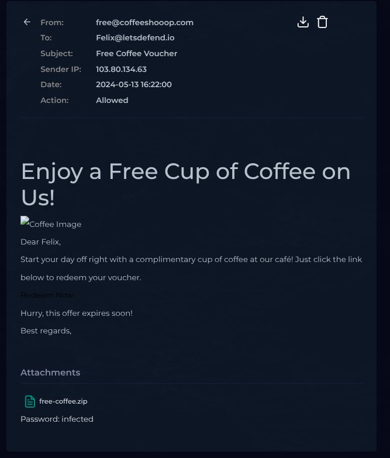
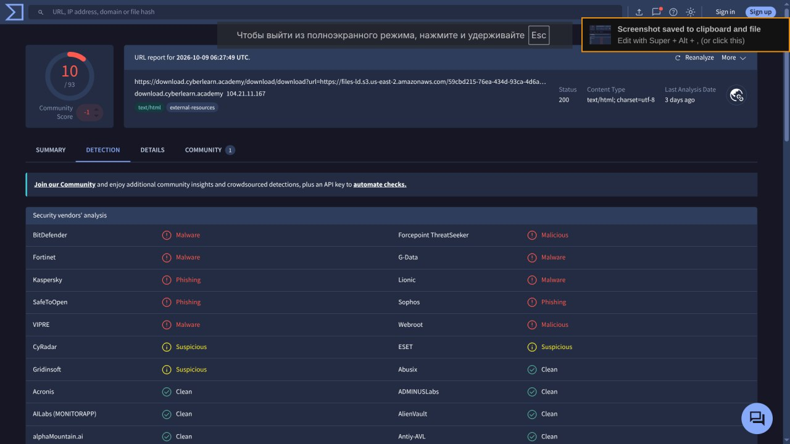

# Phishing Case 001

## Платформа
 LetsDefend 

2024-05-13T09:22:00+03:00
SMTP-адрес: 103.80.134.63
Действие устройства:Допустимый
Тема электронного письма: Бесплатный купон на кофе
Адрес источника: free@coffeeshooop.com
Адрес назначения: Felix@letsdefend.io

Кейс-задание представляет собой письмо на эллектронную почту с возможным зараженным файлом,ссылкой.
Надо проверить считается ли письмо фишинговым или ложная тревога.

Field - value
type - exchange 

source_address - 103.80.134.63

source_port - 45078

destination_address - 172.16.20.3

destination_port - 25

time - 2024-05-13 16:20:33

Было проведенно более полный анализ и обнаруженно в письме .zip файл, ссылку введущую на неизвестный файл.

После проверки на VirusTotal было подтверждена гипотеза о том что данный файл является вирусом.

## Вердикт - true positive.

## Оценка
Кейс представляет собой анализ писем, что является интересным для развития и повышения квавилификации.
